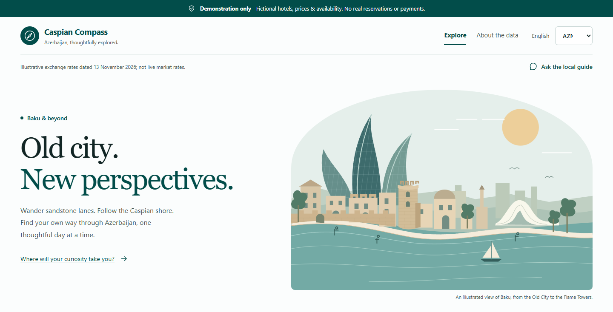

# Caspian Compass

Caspian Compass began as a **live presentation at BAKU AI Summit**. We asked the
audience for app ideas, the audience voted, and a Baku and Azerbaijan travel app
won. The challenge was to build a proof of concept within a **40-minute live
timebox**.

**Lee Stott** worked on the **Microsoft Foundry hosted-agent solution** in this
repository. **David Lopez** worked on a separate **Microsoft Copilot Studio
solution** for the same audience-selected idea. This repository contains the
Foundry implementation, not the Copilot Studio implementation.

The repository includes the proof of concept and follow-up integration,
validation, and documentation. The 40-minute challenge is not a claim that every
feature or check was completed on stage, or that this is production-ready.

**This is a demonstration, not a travel agency.** Hotels, availability, activity
slots, prices, payments, and bookings are synthetic. No real reservation, payment,
ticket, or visa is created.



*An actual application capture using fictional demo data, not a photograph of
the live presentation.*

Read [how it was developed and view the screenshot tour](docs/development.md).
The **original specification** is included as
[readable Markdown](docs/specification.md) and a
[public Word copy](docs/specification.docx). The Word copy has document metadata
removed without changing the visible requirements.

## Run locally

Prerequisites: Python 3.13, [uv](https://docs.astral.sh/uv/), Node.js 22.12 or later,
and npm. Setup restores the committed Python and npm lockfiles. Azure CLI and Azure
Developer CLI are needed for the Foundry configuration, not structured search.

```powershell
.\scripts\Setup-Demo.ps1
.\scripts\Start-Demo.ps1
```

Open `http://127.0.0.1:8000`. The API serves the built web application on the same
origin, so session cookies and API calls work without permissive CORS.

For frontend development, run the API and, in a second terminal:

```powershell
Set-Location web
npm run dev
```

The Vite development server proxies `/api` to the local Python API. Structured
search and simulated bookings work without an AI connection. Natural-language
parsing and the travel assistant require a configured, reachable hosted agent;
an unavailable agent produces an explicit error, not a fabricated answer.

## Demonstrate the journey

1. Search London to Baku for four nights in April, with a mid-range budget and
   history and food interests.
2. Compare fictional hotels, select a room, inspect the activity scores, and
   review the day-by-day itinerary, H1 airport transfer, and travel checklist.
3. Add Shahdag to a December search to see skiing; repeat in July to see it
   excluded. Try a sixteen-night stay for registration guidance and thirty-one
   nights for the e-visa limit warning.
4. Complete the simulated checkout using the published test card
   `4242424242424242`. Any card outside the test allow-list is rejected.
5. Download the watermarked PDF itinerary and calendar file from a
   `SIM-BAK-XXXXXX` confirmation.

Do not enter real payment information. Use fictional traveller details when
presenting the demo. Passport expiry is used transiently for the validity check
and is never retained.

## Architecture

| Component | Location | Responsibility |
| --- | --- | --- |
| React / TypeScript / Vite | `web/` | Search, comparison, itinerary, checkout, sources, and assistant |
| FastAPI | `server/caspian/api.py` | Validated, session-isolated REST endpoints |
| Travel engine | `server/caspian/catalog.py`, `planning.py` | Seeded inventory, weighted scoring, schedules, transport, checklist |
| SQLite | `server/caspian/storage.py` | Single-instance demo sessions and transactional simulated holds |
| Hosted agents | `server/main.py`, `server/caspian/agent_runtime.py` | Foundry concierge and specialist travel assistance |
| JSON interface | `contracts/api.ts` | Shared response shapes used by the interface |

The structured search path does not wait for a language model. Deterministic
code, not the model, owns prices, date arithmetic, scoring, inventory, and state
transitions. Hosted agents can explain and interpret travel requests but cannot
make bookings or claim that anything is reserved.

## Grounding and data boundaries

The seed catalogue follows the supplied specification: twelve fictional hotels
in real districts and fifteen activities based on real attractions. Synthetic
records reference dated travel facts. The original specification baseline is
13 November 2026; this date is **not** a claim that every source has subsequently
been checked. Facts older than ninety days are flagged for review.

Schedules, fares, entry rules, and exchange rates are planning illustrations, not
live quotes. Follow the source links and confirm information before travel.
Conditional rail routes include uncertainty and road alternatives. The
application excludes unsupported or unsafe regional recommendations and does not
plan international land-border crossings.

Demo sessions and their inventory are purged on the next UTC date boundary.
Holds expire after fifteen minutes. SQLite is suitable for this single-instance
proof of concept; it is not a substitute for a production, replicated database.

## Checks

```powershell
Set-Location server
.\.venv\Scripts\python.exe -m pytest tests -q
Set-Location ..\web
npm run build
npm run test:e2e
Set-Location ..
python .\scripts\smoke_demo.py
python .\scripts\benchmark_search.py
```

The browser journey uses installed Microsoft Edge and a running local API.
The benchmark also requires the local API to be running. It sends one burst of one
hundred concurrent structured searches, checks the required trip shape, and
reports whether the measured p95 is below 1.5 seconds. A local benchmark is not
a production load or 99.5% availability guarantee.

Regenerate a dated, grounded data snapshot with a fixed seed:

```powershell
python .\scripts\generate_demo_data.py --seed 42 --output .data\seed-42.json
```

The generator refuses to overwrite an existing snapshot. Change the output name
for another run. It validates that every synthetic record has valid fact references.

## Connect your own Foundry project

The demonstrated solution used Microsoft Foundry hosted agents in North Central
US, with a `gpt-5.4-mini` GlobalStandard model deployment. One hosted runtime
contains the concierge, itinerary specialist, and travel-facts specialist. These
are three runtime agents inside one hosted deployment, not three separate Azure
services. The React application and REST API run locally.

Use your own authorized Azure subscription, Foundry project, and model quota.
The presenter's subscription, directory, resource names, and endpoint are
deliberately omitted from these public docs. Sharing the repository or screenshots
does not give access to a demo Azure environment.

For a fresh checkout, copy `server/.env.example` to `server/.env` **only if it
does not already exist**. Set `FOUNDRY_PROJECT_ENDPOINT` to your actual project
endpoint and `CASPIAN_FOUNDRY_AGENT_NAME` to your deployed hosted agent's name.
The endpoint has this shape, with your own values:

```text
https://YOUR_ACCOUNT.services.ai.azure.com/api/projects/YOUR_PROJECT
```

Azure authentication uses `DefaultAzureCredential`, which obtains credentials
from a permitted signed-in identity or supported Azure identity. There is no
model API key in the browser. Keep actual configuration in ignored environment
files, not in screenshots or public documentation.

The assistant and natural-language parser make actual hosted-agent calls. They
typically take tens of seconds, unlike the fast deterministic search. Interpreted
search fields are always shown for confirmation. Specialist attribution comes
from completed hosted tool calls, not a fabricated activity display.

The deployment definition is [azure.yaml](azure.yaml). Follow the
[Foundry hosted-agent guidance](https://learn.microsoft.com/azure/ai-foundry/agents/concepts/hosted-agents?view=foundry)
to prepare your Azure Developer CLI environment, permissions, and available
capacity. For updates to an environment you have already configured, replace
`YOUR_ENVIRONMENT_NAME` below:

```powershell
azd env select "YOUR_ENVIRONMENT_NAME"
azd deploy --no-prompt
azd ai agent invoke --protocol responses "What is the H1 airport bus fare?"
```

Keep `server/uv.lock` and the fully pinned `server/requirements-agent.txt`
consistent when changing dependencies: the remote build uses the requirements
files, while local setup uses the uv lock. Azure hosting and model usage can incur
charges. Resource cleanup is an explicit operator action, never part of running
the demonstration.

See [the public implementation plan](.azure/plan.md) for scope and safeguards,
and [the development notes](docs/development.md#what-the-proof-of-concept-changed)
for differences from the original specification.
Never commit `.env`, Azure environment state, credentials, or the SQLite database.