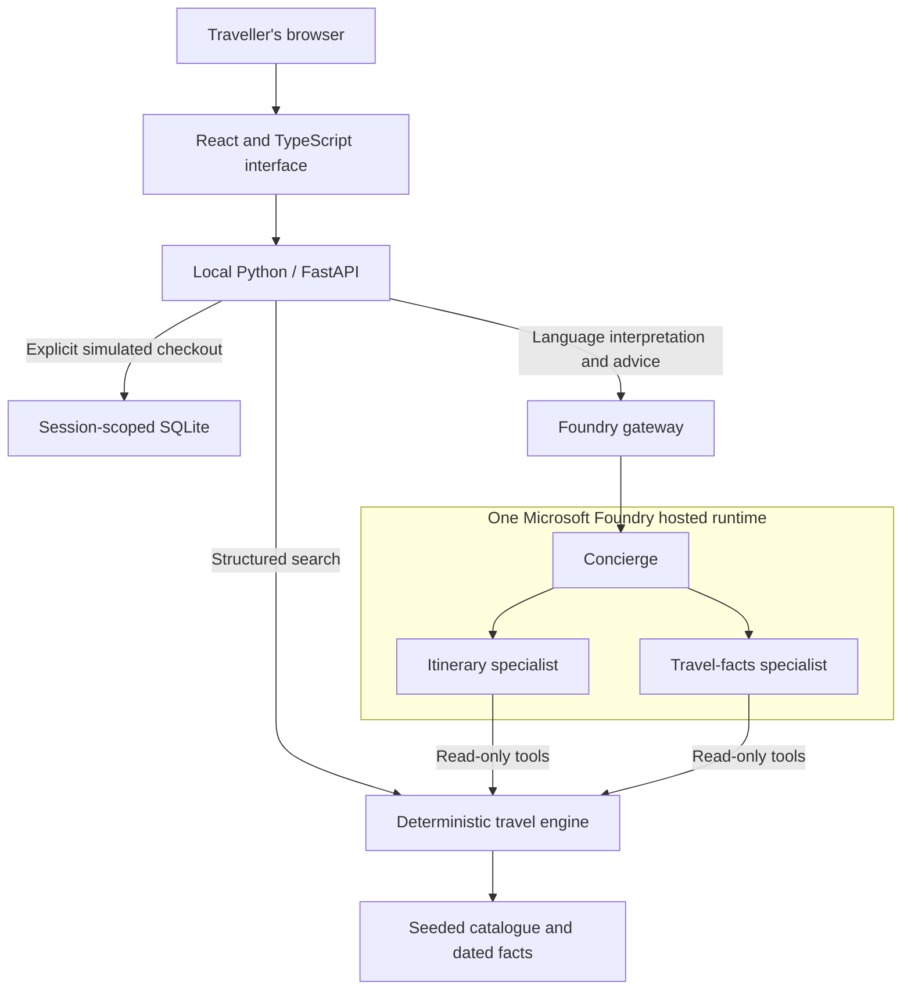
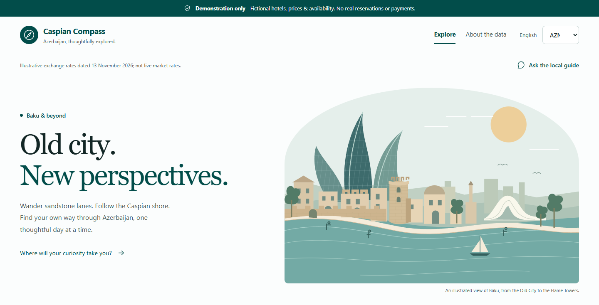
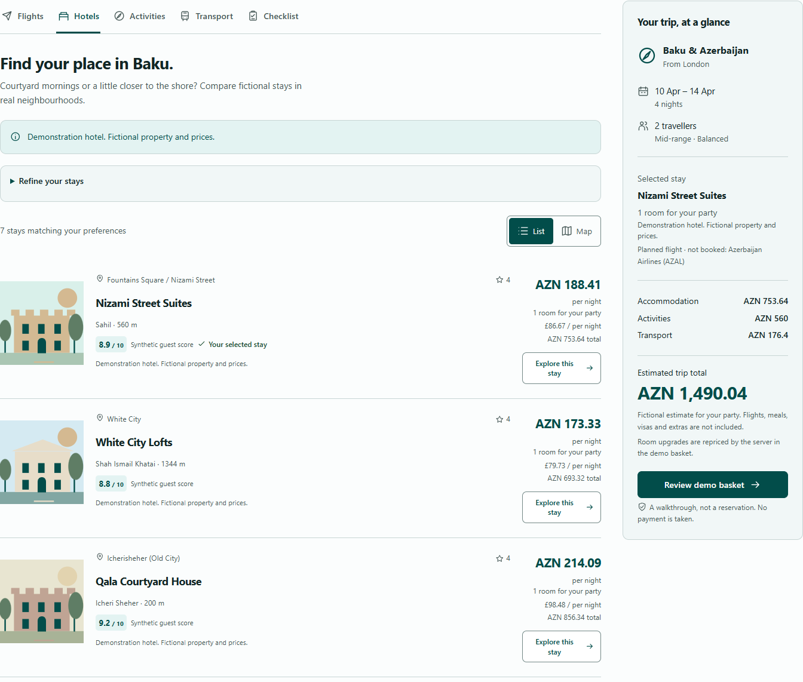
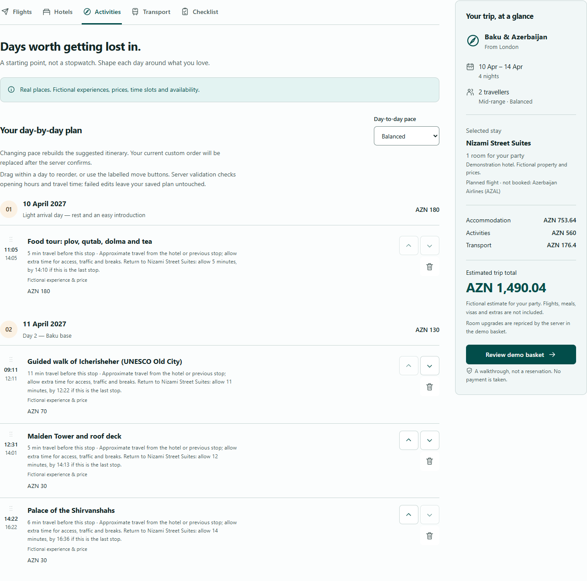
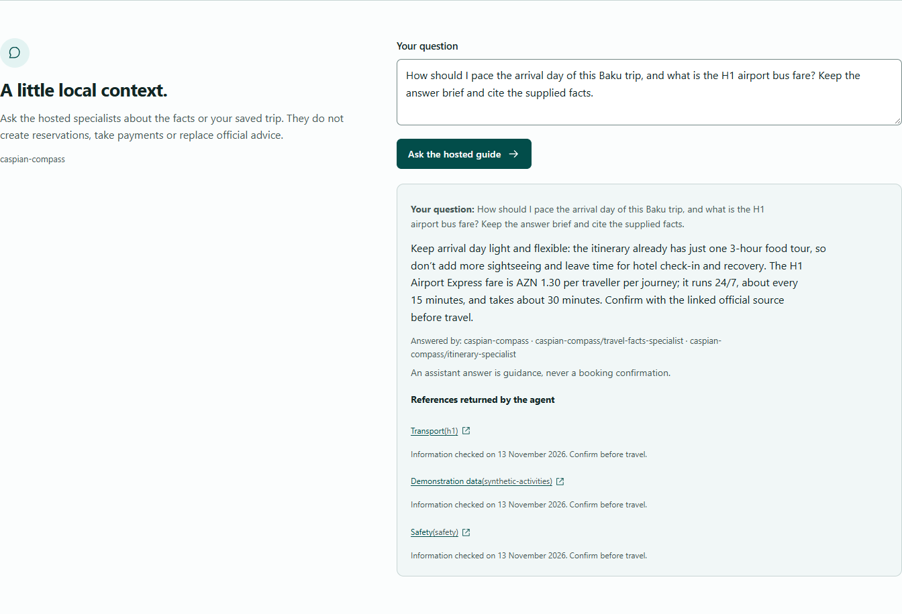
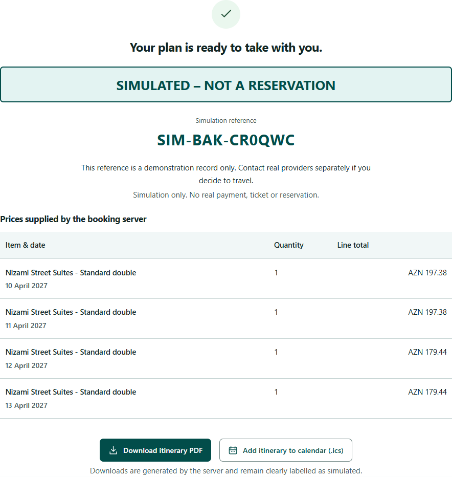

# From an audience idea to Caspian Compass

At a **live presentation at BAKU AI Summit**, we asked the audience for application
ideas and invited them to vote. The winning idea was a travel app for Baku and
Azerbaijan: help a visitor decide where to stay, what to do, and how to get around.

The presenters had a **40-minute live timebox** to build a proof of concept.
This repository captures the Foundry solution and its follow-up integration,
validation, and documentation. It is not a claim that the full specification or
every check was completed during those 40 minutes.

## One audience choice, two implementation approaches

The audience selected the **app idea**, not a winning technology platform. The
same travel-app concept gave the presenters a concrete problem to explore using
two different Microsoft agent-building approaches.

The work was split between the presenters as follows. Only the Foundry
implementation is included here; this repository does not contain a Copilot
Studio export or make claims about feature parity between the two solutions.

| Presenter | Implementation |
| --- | --- |
| **Lee Stott** | **Microsoft Foundry hosted-agent solution**, with custom application code and shared travel-planning tools |
| **David Lopez** | A separate **Microsoft Copilot Studio solution** for the same audience-selected travel-app idea |

## Turning the idea into something buildable

The [original specification](specification.md) made the idea concrete. It defined
the traveller's inputs, fictional hotel inventory, seasonal activities, transport
guidance, and a simulated booking journey. That gave the coding agents a shared
target instead of an open-ended request to "build a travel app."

The key boundary was agreed before implementation: **nothing could make a real
booking or take a real payment**. Python and SQLite were chosen for this proof of
concept, and Foundry hosted agents became a required part of the implementation
rather than the optional assistant described in the original brief.

### Four parallel coding workstreams

GitHub Copilot coordinated four coding agents in parallel. These were
**development-time helpers**, not the agents a traveller talks to in the finished
application. Each workstream had defined file ownership and used the same
[JSON interface contract](../contracts/api.ts), which describes the data passed
between the browser and API.

| Workstream | What it built | Main code |
| --- | --- | --- |
| Travel engine | Seeded hotels, availability, activity scoring, itineraries, flights, transport and checklists | [`catalog.py`](../server/caspian/catalog.py), [`planning.py`](../server/caspian/planning.py) |
| API and booking | Validated requests, isolated demo sessions, transactional inventory holds, mock payment and exports | [`api.py`](../server/caspian/api.py), [`booking.py`](../server/caspian/booking.py), [`storage.py`](../server/caspian/storage.py) |
| Web interface | Search, trip tabs, hotel list/map, itinerary editing, source references and simulated checkout | [`web/src`](../web/src) |
| Foundry platform | Hosted runtime, specialist agents, application gateway, deployment and remote invocation | [`agent_runtime.py`](../server/caspian/agent_runtime.py), [`foundry.py`](../server/caspian/foundry.py), [`azure.yaml`](../azure.yaml) |

The coordinator integrated these outputs instead of treating four separate
implementations as a finished application. Shared contracts helped, but real
integration still mattered: request validation, room quantities, saved activity
selections and browser state all had to agree.

### Integration was more than a successful build

Checks covered the traveller's complete journey, including seasonal ski
eligibility, registration and e-visa thresholds, session isolation, expired
holds, non-test-card rejection, and real PDF/calendar downloads. The browser
journey also exercised desktop and narrow mobile layouts.

Follow-up integration corrected issues such as removed activities being restored
when other trip details changed, a mismatch between the passport-date form and
API, and a map animation continuing after its view was closed. The hosted build
also needed consistent dependency pins and decoding of the final assistant
message rather than concatenated intermediate responses.

The original brief included a 1.5-second p95 search target at 100 concurrent
users. Here, **p95** means that 95% of measured requests finished within that
time. A local burst of 100 simultaneous structured searches met the target; this
is not a production load, geographic-latency or availability guarantee. The
[verification commands](../README.md#checks) make those checks repeatable.

## How the Foundry solution works

A **hosted agent** is custom agent code run by Microsoft Foundry. This solution
uses one hosted Python runtime containing three Microsoft Agent Framework
agents: a concierge and two specialists. The concierge delegates questions to
the itinerary specialist and travel-facts specialist through read-only tools.

The application keeps calculation and conversation separate. **Deterministic
code** means the same inputs and seed produce the same result. That code owns
prices, ranking weights, opening-hour checks, inventory and booking transitions.
The language model interprets requests and explains supplied information; it
does not decide whether money was paid or a reservation exists.

The hosted scaffold followed the
[official Python Agent Framework local-tools sample](https://github.com/microsoft-foundry/foundry-samples/tree/main/samples/python/hosted-agents/agent-framework/responses/02-tools).
Its `ResponsesHostServer` adapter exposes the hosted protocol; the application
adds travel-specific tools rather than implementing a competing protocol layer.
[Azure Developer CLI](https://learn.microsoft.com/azure/developer/azure-developer-cli/overview)
uses `azure.yaml` to provision the project and deploy the Python entry point.
Pinned dependencies keep local execution and the remote build aligned.

Natural-language search returns proposed fields for the traveller to confirm
before running a search. Structured search does not wait for a model and can
work without Azure configuration. AI failures are reported explicitly rather
than replaced with a made-up successful answer.

Grounding means using supplied reference information rather than inventing
facts. Responses cite entries from the fact catalogue, and the interface shows
source links and baseline dates. Those citations do not turn historical
information into current travel advice: fares, entry rules, weather conditions,
and timetables still need confirmation.

## What the proof of concept changed

The specification is retained as the **original brief**, not rewritten to look
as though every proposed feature was delivered. Its broader architecture and
multi-week delivery roadmap describe more than a timeboxed demonstrator.

The table below makes the main choices and limitations explicit. It also
distinguishes genuine runtime functionality from live supplier integrations or
production guarantees that this repository does not provide.

| Original brief or ambition | This proof of concept |
| --- | --- |
| Suggested Node.js or ASP.NET Core API | Python/FastAPI, sharing travel logic with the Python hosted runtime |
| PostgreSQL with PostGIS | Local, single-instance SQLite for demo sessions and inventory; catalogue geography is approximate |
| Optional AI assistant | Required Foundry hosted-agent integration for language interpretation and grounded advice |
| Azure web, API and database hosting | The browser application and API run locally; the agent runtime is hosted in Foundry |
| Regional exploration | One selected hotel base for all nights, with feasible excursions; not a multi-hotel overnight booking system |
| English, Azerbaijani and Russian readiness | English interface with copy structured for later localization; Azerbaijani and Russian translations are not delivered |
| Season and weather awareness | Seasonal rules, not a live weather feed |
| Flight recommendations and current transport details | Dated route patterns, synthetic fares and conditional rail guidance; no live availability |
| Historical Baku-Tbilisi rail example in the original text | International land-border itineraries are excluded rather than resolving contradictory source claims by guessing |
| Grounding facts labelled verified in the original brief | Preserved as a specification baseline dated 13 November 2026, not a claim of fresh independent verification |
| Production performance, availability and accessibility ambitions | Focused functional, load-burst, keyboard and responsive checks; not a production SLA or formal accessibility certification |
| Booking-like experience | Test-card-only simulation, explicit watermark, no supplier booking and no real payment |

## Screenshot tour

These are **actual captures of the running application**, prepared for the
public documentation using a fresh browser session, seed `42`, fictional
traveller details and synthetic inventory. They are not photographs or screen
recordings of the live presentation.

The screenshots contain application content rather than browser chrome, Azure
portal pages, account menus or terminal output. Prices and source dates visible
in them are demonstration data, not offers to buy travel.

### Start with the audience's travel idea

The home page introduces Baku and the simulation boundary before the traveller
starts a plan.

### Compare fictional hotels

Real neighbourhoods provide context, while the hotels, scores, inventory and
prices remain fictional.

### Arrange the day-by-day plan

The itinerary view exposes timing and travel constraints instead of presenting
an unexplained list of suggestions. This capture shows an excerpt of the plan.

### Ask the hosted specialists

This answer came from the deployed hosted runtime. The displayed specialist
names come from completed tool calls; they are not decorative activity labels.

### Finish without making a reservation

The `SIM-BAK-` reference is a fictional demo record. No payment was taken, and
neither the confirmation nor its downloads are real tickets or reservations.

## The original specification and public-sharing boundaries

The [Markdown specification](specification.md) preserves the supplied
requirements, all 18 tables and source list. Only document layout and the
generated Word table of contents were replaced. The
[downloadable Word copy](specification.docx) preserves the visible source text
while removing document properties and unused authoring XML. The source file
itself was not modified.

Subscription and directory identifiers, deployment-specific resource names,
private project endpoints, local machine paths and private document-sharing
links are not part of these public docs. Runtime environment files and the
SQLite database remain ignored by Git. Presenter names above are intentional
event credits, not account or contact details.

To try the Foundry implementation, start with the
[local setup instructions](../README.md#run-locally) and connect an authorized
project of your own for AI features. When sharing new captures, use a fresh demo
session and preserve the fictional-data labels and confirmation watermark.
Recheck travel information with official sources rather than relying on a
screenshot or the historical specification.
